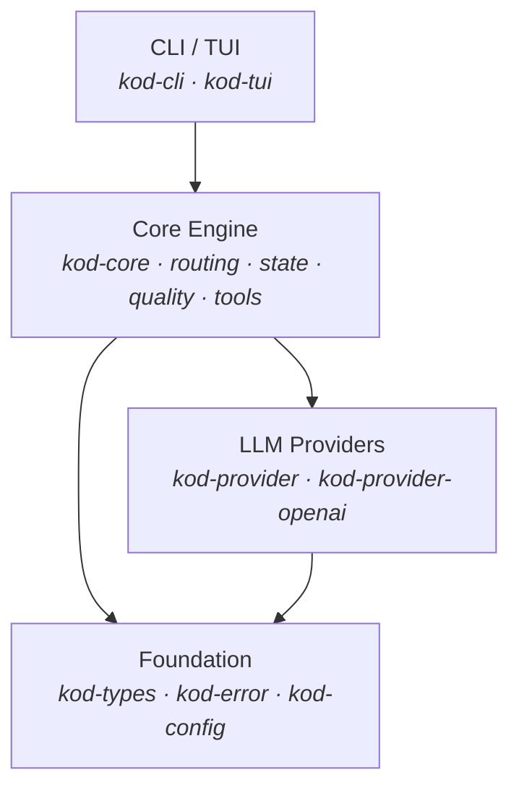

import { Aside, Code, LinkCard } from '@astrojs/starlight/components';

> **Primary crate:** [`kod-core`](/reference/crates/#engine). Sub-crates: [`kod-core-routing`](/reference/crates/#engine), [`kod-core-state`](/reference/crates/#engine), [`kod-core-serve`](/reference/crates/#engine), [`kod-core-quality`](/reference/crates/#engine), [`kod-core-tools`](/reference/crates/#engine). See [Core crates](/explanation/core-crates/).

KOD is a multi-crate Rust workspace where each crate has a single responsibility and a narrow public API, so each part can be built and reasoned about in isolation. Twenty-six crates stack into four layers:

<Code lang="text" code={"\u250c\u2500\u2500\u2500\u2500\u2500\u2500\u2500\u2500\u2500\u2500\u2500\u2500\u2500\u2500\u2500\u2500\u2500\u2500\u2500\u2500\u2500\u2500\u2500\u2500\u2500\u2500\u2500\u2500\u2500\u2500\u2500\u2500\u2500\u2500\u2500\u2500\u2500\u2500\u2500\u2500\u2500\u2500\u2500\u2500\u2500\u2500\u2500\u2500\u2500\u2500\u2500\u2500\u2500\u2510\n\u2502                    CLI / TUI                         \u2502\n\u2502           (kod-cli, kod-tui)                        \u2502\n\u251c\u2500\u2500\u2500\u2500\u2500\u2500\u2500\u2500\u2500\u2500\u2500\u2500\u2500\u2500\u2500\u2500\u2500\u2500\u2500\u2500\u2500\u2500\u2500\u2500\u2500\u2500\u2500\u2500\u2500\u2500\u2500\u2500\u2500\u2500\u2500\u2500\u2500\u2500\u2500\u2500\u2500\u2500\u2500\u2500\u2500\u2500\u2500\u2500\u2500\u2500\u2500\u2500\u2500\u2524\n\u2502                   Core Engine                        \u2502\n\u2502                      (kod-core)                     \u2502\n\u251c\u2500\u2500\u2500\u2500\u2500\u2500\u2500\u2500\u2500\u2500\u2500\u2500\u2500\u2500\u2500\u2500\u2500\u2500\u2500\u2500\u2500\u2500\u2500\u2500\u2500\u2500\u2500\u2500\u2500\u2500\u2500\u2500\u2500\u2500\u2500\u2500\u2500\u2500\u2500\u2500\u2500\u2500\u2500\u2500\u2500\u2500\u2500\u2500\u2500\u2500\u2500\u2500\u2500\u2524\n\u2502                LLM Providers                         \u2502\n\u2502        (kod-provider, kod-provider-openai)           \u2502\n\u251c\u2500\u2500\u2500\u2500\u2500\u2500\u2500\u2500\u2500\u2500\u2500\u2500\u2500\u2500\u2500\u2500\u2500\u2500\u2500\u2500\u2500\u2500\u2500\u2500\u2500\u2500\u2500\u2500\u2500\u2500\u2500\u2500\u2500\u2500\u2500\u2500\u2500\u2500\u2500\u2500\u2500\u2500\u2500\u2500\u2500\u2500\u2500\u2500\u2500\u2500\u2500\u2500\u2500\u2524\n\u2502                   Foundation                         \u2502\n\u2502        (kod-types, kod-error, kod-config)            \u2502\n\u2514\u2500\u2500\u2500\u2500\u2500\u2500\u2500\u2500\u2500\u2500\u2500\u2500\u2500\u2500\u2500\u2500\u2500\u2500\u2500\u2500\u2500\u2500\u2500\u2500\u2500\u2500\u2500\u2500\u2500\u2500\u2500\u2500\u2500\u2500\u2500\u2500\u2500\u2500\u2500\u2500\u2500\u2500\u2500\u2500\u2500\u2500\u2500\u2500\u2500\u2500\u2500\u2500\u2500\u2518"} />

## The twenty-six crates

| Crate | Responsibility |
| --- | --- |
| `kod-types` | Shared types: strongly-typed IDs (`AgentId`, `MessageId`, `SkillId`, …), messages, skills, memory, tools. |
| `kod-error` | `KodError` enum and `Result` alias — comprehensive errors with recovery detection. |
| `kod-config` | Configuration parsing and validation: endpoints, routing, memory, skills, swarm, hooks, MCP, and the policy engine's config side. |
| `kod-provider` | The `LlmProvider` trait, `GenerationOptions`, and streaming chunk types. |
| `kod-provider-openai` | OpenAI-compatible implementation (backed by `adk-model`): one code path for Ollama, LM Studio, MLX, vLLM, OpenAI. |
| `kod-skills` | Skill parser, loader, matcher, and hot-reload watcher. |
| `kod-memory` | Short-term memory and long-term `redb` storage, plus the context builder. |
| `kod-tools` | `Tool` trait, registry, the 24 built-in tools, per-path lock table, sandbox invocation. |
| `kod-swarm` | Agent lifecycle, communication hub, task coordinator, shared workspace. |
| `kod-core` | `KodEngine`, `TaskRouter`, `SwarmRunner`, repository map, session log, hooks, LSP and MCP integration. |
| `kod-tui` | Terminal UI: app state, event handling, widgets, keybindings, themes. |
| `kod-cli` | The `kod` binary: command definitions and handlers. |

The layering is strict: interfaces depend on core, core depends on providers and the domain crates, and everything sits on the foundation. No crate reaches sideways past the layer below it.

## Data flow through one round

<Code lang="text" code={"user input\n   \u2502\n   \u25bc\n\u250c\u2500\u2500\u2500\u2500\u2500\u2500\u2500\u2500\u2500\u2500\u2500\u2500\u2500\u2500\u2500\u2500\u2510   \u250c\u2500\u2500\u2500\u2500\u2500\u2500\u2500\u2500\u2500\u2500\u2500\u2500\u2500\u2500\u2500\u2500\u2510   \u250c\u2500\u2500\u2500\u2500\u2500\u2500\u2500\u2500\u2500\u2500\u2500\u2500\u2500\u2500\u2500\u2500\u2510\n\u2502  TaskRouter    \u2502\u2500\u2500\u25b6\u2502  Memory +      \u2502\u2500\u2500\u25b6\u2502  Grounded      \u2502\n\u2502  (classify)    \u2502   \u2502  Skill match   \u2502   \u2502  prompt        \u2502\n\u2514\u2500\u2500\u2500\u2500\u2500\u2500\u2500\u2500\u2500\u2500\u2500\u2500\u2500\u2500\u2500\u2500\u2518   \u2514\u2500\u2500\u2500\u2500\u2500\u2500\u2500\u2500\u2500\u2500\u2500\u2500\u2500\u2500\u2500\u2500\u2518   \u2514\u2500\u2500\u2500\u2500\u2500\u2500\u2500\u2500\u2500\u2500\u2500\u2500\u2500\u2500\u2500\u2500\u2518\n                                                \u2502\n                                                \u25bc\n\u250c\u2500\u2500\u2500\u2500\u2500\u2500\u2500\u2500\u2500\u2500\u2500\u2500\u2500\u2500\u2500\u2500\u2510   \u250c\u2500\u2500\u2500\u2500\u2500\u2500\u2500\u2500\u2500\u2500\u2500\u2500\u2500\u2500\u2500\u2500\u2510   \u250c\u2500\u2500\u2500\u2500\u2500\u2500\u2500\u2500\u2500\u2500\u2500\u2500\u2500\u2500\u2500\u2500\u2510\n\u2502  Tool results  \u2502\u25c0\u2500\u2500\u2502  LLM provider  \u2502\u2500\u2500\u25b6\u2502  Streaming     \u2502\n\u2502  fed back      \u2502   \u2502  (streaming)   \u2502   \u2502  chunks \u2192 UI   \u2502\n\u2514\u2500\u2500\u2500\u2500\u2500\u2500\u2500\u2500\u2500\u2500\u2500\u2500\u2500\u2500\u2500\u2500\u2518   \u2514\u2500\u2500\u2500\u2500\u2500\u2500\u2500\u2500\u2500\u2500\u2500\u2500\u2500\u2500\u2500\u2500\u2518   \u2514\u2500\u2500\u2500\u2500\u2500\u2500\u2500\u2500\u2500\u2500\u2500\u2500\u2500\u2500\u2500\u2500\u2518\n        \u2502\n        \u25bc\n\u250c\u2500\u2500\u2500\u2500\u2500\u2500\u2500\u2500\u2500\u2500\u2500\u2500\u2500\u2500\u2500\u2500\u2510   \u250c\u2500\u2500\u2500\u2500\u2500\u2500\u2500\u2500\u2500\u2500\u2500\u2500\u2500\u2500\u2500\u2500\u2510\n\u2502  Final reply   \u2502\u2500\u2500\u25b6\u2502  Session log   \u2502\n\u2502  \u2192 CLI / TUI   \u2502   \u2502  (JSONL)       \u2502\n\u2514\u2500\u2500\u2500\u2500\u2500\u2500\u2500\u2500\u2500\u2500\u2500\u2500\u2500\u2500\u2500\u2500\u2518   \u2514\u2500\u2500\u2500\u2500\u2500\u2500\u2500\u2500\u2500\u2500\u2500\u2500\u2500\u2500\u2500\u2500\u2518"} />

1. **User input** arrives from the CLI or TUI.
2. **Task classification** (`kod-core::router`) decides the task type and how the round is shaped.
3. **Context building** (`kod-memory`, `kod-skills`) assembles memory entries and matched skills.
4. **LLM generation** (`kod-provider-*`) streams tokens and assembles tool calls live.
5. **Tool execution** (`kod-tools`) runs policy-gated calls and feeds results back.
6. **Response** reaches the interface while the **session log** records everything.

## Design principles

1. **Modularity** — each crate has a single responsibility and a narrow public API.
2. **Performance** — zero-copy parsing, object pooling, caching, connection reuse.
3. **Extensibility** — trait-based abstractions for providers and tools; MCP servers plug in from config.
4. **Type safety** — strongly-typed IDs prevent mixing an `AgentId` with a `SessionId`.
5. **Error handling** — comprehensive error types with recovery detection.
6. **Fail loudly** — corrupt configs warn and recover, missing sandbox primitives abort, absent providers refuse instead of inventing answers.
7. **Documentation** — every component documented; docs describe the code as it is.

## Performance posture

The workspace is deliberate about resource use: Tokio-based async I/O throughout, multi-level caching for skills and memory, object pooling and string interning to keep allocations down, and HTTP connection reuse for the provider. None of it is exotic — it is the accumulation of choosing allocations carefully in a program that streams tokens while running tools.

## What is deliberately not here

The in-repo `docs/SPEC.md` describes a larger aspirational system — a debugger integration, a full plugin API. Those are design references, not built features. LSP integration, MCP servers, and vector-based semantic memory, by contrast, *are* built and documented on this site. The architecture above is the system as it exists.

<Aside type="note">
  The [README's Project Status](https://github.com/elcoosp/kod#project-status) section is the authoritative list of what works end-to-end versus what is on the roadmap; this site follows it.
</Aside>

<LinkCard title="Concepts: The Agent Loop" href="/explanation/agent-loop/" description="What happens inside one engine round, step by step." />

## See also

- [Crates reference](/reference/crates/) — full index of all 26 workspace crates
- [Core crates](/explanation/core-crates/) — how the engine's internal sub-crates fit together
- [Agent loop](/explanation/agent-loop/) — the turn lifecycle
- [Compaction](/explanation/compaction/) — context reduction across turns
